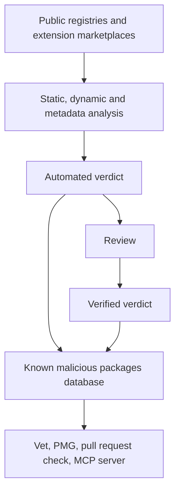

A malicious package is an open-source package built or altered to harm whoever installs it. For example, it steals secrets, opens a backdoor, or runs unwanted code. Unlike a [vulnerability](/concepts/vulnerability), which is an unintended flaw in an otherwise legitimate package, a malicious package is harmful by design.

## Common forms

- **Typosquatting and dependency confusion:** a package named to be mistaken for a popular or internal one.
- **Malicious install scripts:** code that runs the moment a package is installed, before you ever import it.
- **Backdoors and data exfiltration:** harmful behavior hidden inside otherwise working code.
- **Compromised releases:** malicious code injected into a previously trusted package, usually in a fresh version.

## How SafeDep detects them

SafeDep monitors public package registries and extension marketplaces. It analyzes new and updated packages with:

- **Static analysis** of the package's code, such as suspicious code patterns and obfuscation.
- **Dynamic analysis** of its runtime behavior, such as network, file system, and process activity.
- **Metadata analysis** of the package, its publisher and its distribution pattern.

The verdicts go into SafeDep's known malicious packages database. Vet, PMG, the pull request check and the SafeDep MCP server query this database.

## Automated and verified verdicts

A malware verdict is one of two kinds:

- An **automated verdict** comes from the analysis alone. No one has verified it yet, so the package is suspicious.
- A **verified verdict** is confirmed by a human review or a trusted source. The package is malicious.

Tools act on both kinds. On a developer machine, PMG blocks a package with a verified verdict. For a package with an automated verdict, PMG asks you to confirm before it installs. With `--paranoid`, PMG blocks it instead.

### Classification levels

Vet reports each analyzed package at one of three levels:

- **SAFE:** the analysis found no malicious behavior.
- **SUSPICIOUS:** the package has an automated verdict.
- **MALICIOUS:** the package has a verified verdict. With `vet scan --malware-trust-tool-result`, an automated verdict with high confidence is also MALICIOUS.

## Blocking malicious packages

Detection is how SafeDep knows a package is malicious. Blocking it is the job of [Package Security](/package-security/overview):

- [PMG](/package-security/pmg/overview) blocks them at install time on developer machines.
- The [PMG GitHub Action](/package-security/pmg/github-actions) blocks them in CI. No one can confirm an install in CI, so PMG also blocks each package with an automated verdict.
- [Vet](/governance/vet/overview) blocks them in CI/CD.
- The pull request check of the [SafeDep GitHub App](/governance/integrations/github) fails when a pull request adds a package with a verified verdict.
- The [SafeDep MCP server](/ai-security/mcp-server) lets AI coding agents check a package before suggesting it.

Detection takes time after a version is published. The PMG [dependency cooldown](/package-security/pmg/dependency-cooldown) covers this gap. By default, PMG does not install a version that is younger than 2 days.

## Related

<CardGroup cols={2}>
  <Card title="Vulnerability" icon="bug" href="/concepts/vulnerability">
    Learn about unintended flaws in legitimate packages, the other kind of dependency risk.
  </Card>
  <Card title="Package Security" icon="shield-halved" href="/package-security/overview">
    Block malicious packages at every entry point.
  </Card>
  <Card title="On-Demand Package Scanning" icon="shield-virus" href="/package-security/scan/overview">
    Analyze a package on demand in SafeDep Cloud.
  </Card>
  <Card title="Policy" icon="file-shield" href="/concepts/policy">
    Turn detection into enforceable rules.
  </Card>
</CardGroup>
