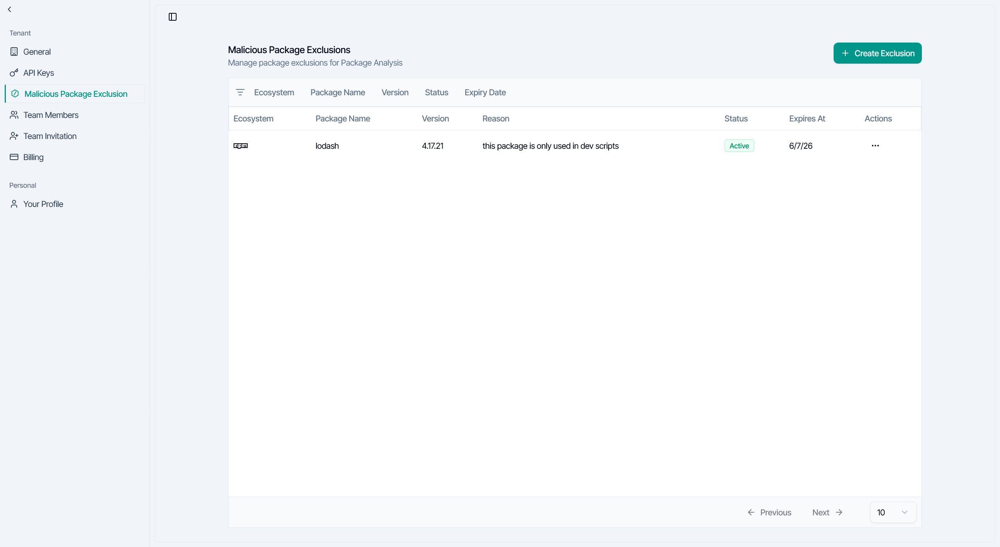
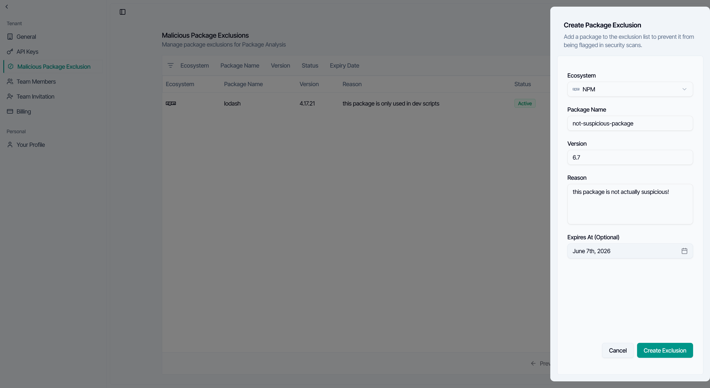
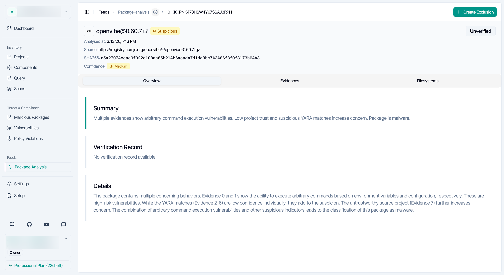
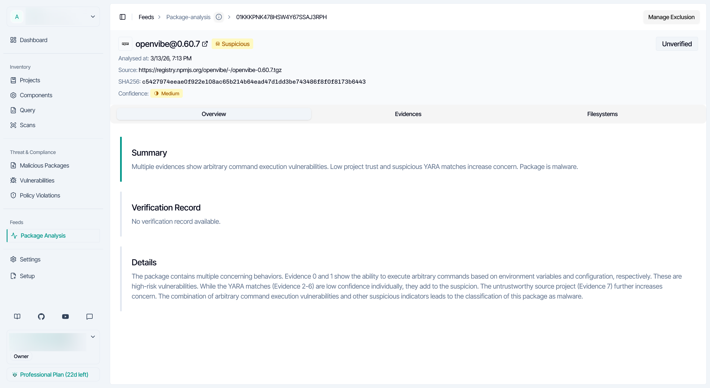
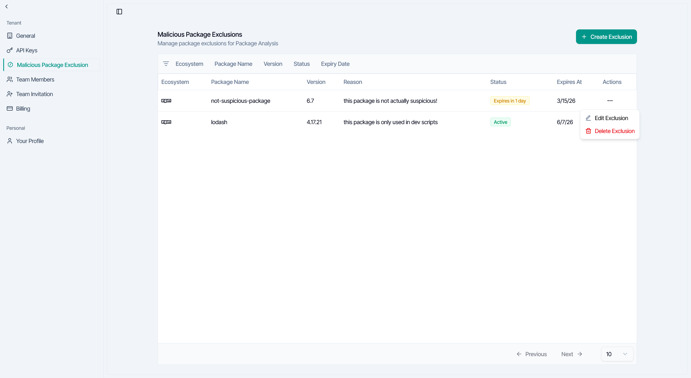

<Warning>
Malicious Package Exclusions are deprecated. A trust entry with the scope `malware` in the [cloud policy](/governance/cloud/policy/overview) replaces them, and a later release removes them. SafeDep Cloud does not copy your exclusions. To move them, and to see which tools still apply them, see [Trust a Package](/governance/cloud/policy/trust-a-package#move-from-malicious-package-exclusions).
</Warning>

<Info>
Malicious Package Exclusions need the SafeDep Cloud **Team** or **Enterprise** plan. See [pricing](https://safedep.io/pricing). If the tenant moves to a lower plan, the exclusions stop applying. In the app, only tenant owners can create, edit or delete an exclusion.
</Info>

An exclusion suppresses a malicious package finding for one package after your team reviews it. It applies only in your tenant, and it does not mark the package as safe anywhere else. It does not change vulnerability findings or other checks.

These tools apply exclusions:

- The package analysis views in `app.safedep.io`
- The GitHub App pull request check
- `vet` and `vet-action` in cloud mode
- PMG with SafeDep Cloud credentials, when its cloud policy is off

## How Exclusions Match

Each exclusion has an ecosystem, a package name, a version, a reason and an optional expiry date.

- **Version:** SafeDep Cloud matches the version exactly. Version `0` is a special value that means all versions, not the literal version `0`. When an exact-version exclusion and an all-versions exclusion both match, the exact version wins.
- **Expiry:** the expiry must be in the future. After it, the exclusion stops applying.
- **Verified malware:** SafeDep Cloud refuses an exclusion for a package that it has verified as malicious. If SafeDep verifies a package after you exclude it, the exclusion stops applying, and so does an all-versions exclusion.

## Create an Exclusion

<Steps>
  <Step title="Open the exclusions page">
    Go to [app.safedep.io/settings/package-exclusions](https://app.safedep.io/settings/package-exclusions) and click **Create Exclusion**.
  </Step>
  <Step title="Fill in the package">
    Set the ecosystem, the package name, the version, the reason and, for a temporary exception, the expiry date. Then save the exclusion.
  </Step>
</Steps>

You can also start from a malicious package result. Its header shows **Create Exclusion**, or **Manage Exclusion** when an exclusion for that package and version exists.

## Manage Exclusions

The exclusions table shows the ecosystem, name, version, reason, status and expiry date of each exclusion. Filter it by ecosystem, name, version, expiry date or status: **Active**, **Expired** or **Expires Soon**. Use the row menu to edit or delete an exclusion. An edit can change the version, the reason, the expiry date and the package identity.

After you delete an exclusion, or after it expires, the package can show up again in analysis results. To see a change, refresh the page or run the scan again. If an exclusion does not apply, check that it has not expired, and that its ecosystem, name and version match the finding. If **Create Exclusion** is disabled, ask your tenant owner.

## Next Steps

<CardGroup cols={2}>
  <Card title="Trust a Package" icon="shield-check" href="/governance/cloud/policy/trust-a-package">
    Replace an exclusion with a trust entry
  </Card>
  <Card title="GitHub App" icon="github" href="/governance/integrations/github">
    See how SafeDep respects exclusions in GitHub pull request checks
  </Card>
  <Card title="Malware Analysis" icon="virus" href="/package-security/scan/malware-lookup">
    Learn how SafeDep Cloud analyzes packages for malicious behavior
  </Card>
  <Card title="Cloud FAQ" icon="question-circle" href="/governance/cloud/faq">
    Find answers to common SafeDep Cloud questions
  </Card>
</CardGroup>
