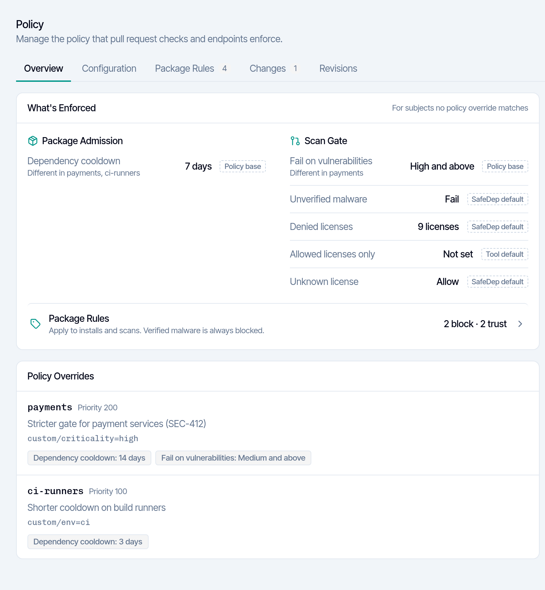
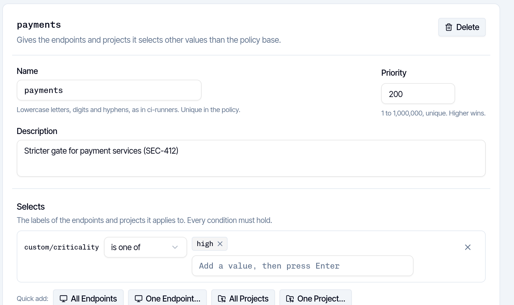
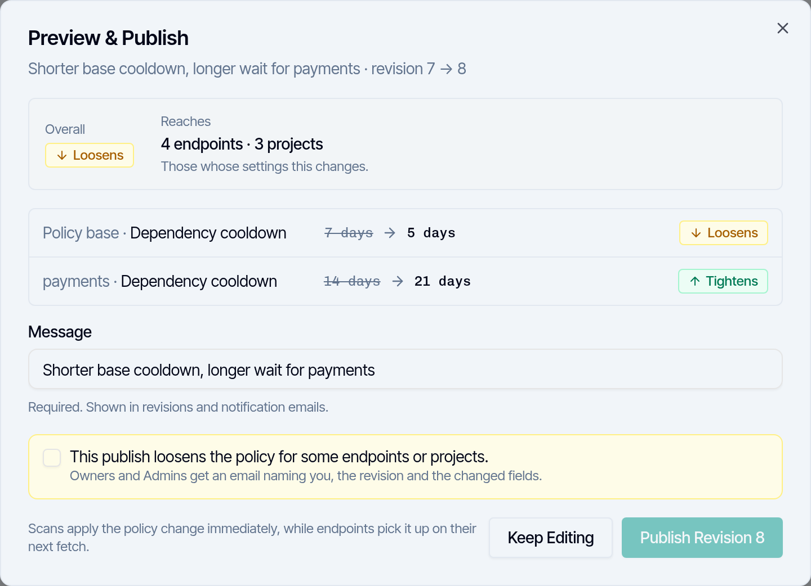
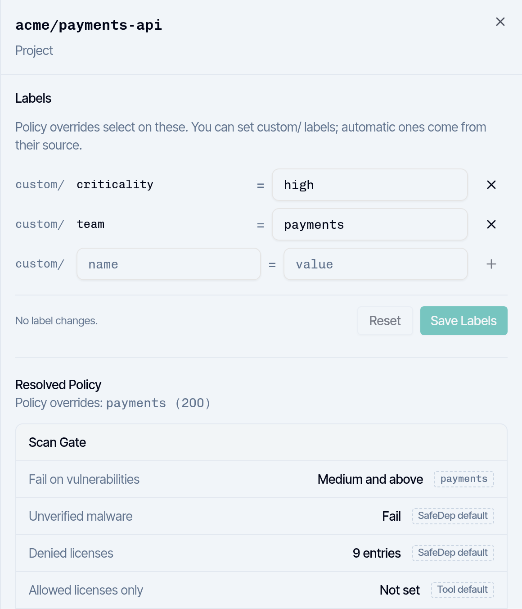

The cloud policy is one [policy](/concepts/policy) for your tenant in SafeDep Cloud. A security admin changes it in SafeDep Cloud at [app.safedep.io](https://app.safedep.io) or with the [safedep CLI](/get-started/cli-tools), and PMG and the pull request checks apply it. You change the policy of the whole fleet with no new MDM package.

<Note>
  The cloud policy needs the SafeDep Cloud Team or Enterprise plan. See [pricing](https://safedep.io/pricing).
</Note>

## What the cloud policy controls

- **Package rules.** Block a package for the whole tenant, or trust one package after a false positive. See [Package Rules](/concepts/package-rules).
- **Dependency cooldown.** Hold back package versions that are younger than a minimum age.
- **Pull request checks.** Choose the lowest vulnerability severity that fails a check, and the licenses that fail it.

You can set a value for the whole tenant, or for a group of endpoints or projects with a policy override. See [Policy Resolution](/concepts/policy-resolution).

## What enforces each part

- **PMG** applies the package rules and the dependency cooldown.
- **The pull request check** applies the package rules and the scan gate, with its license gate.
- **Vet** does not read the cloud policy yet.

For each setting and each trust scope, and the exceptions, see the [settings reference](/reference/cloud-policy-settings).

## Where to manage the policy

SafeDep Cloud and the safedep CLI change the same policy. A change that you make in one shows in the other.

In SafeDep Cloud, the **Cloud Policy** group of the settings sidebar has three pages:

| Page | What it shows |
|---|---|
| **Policy** | The policy, in five tabs: **Overview**, **Configuration**, **Package Rules**, **Changes** and **Revisions** |
| **Endpoints & Projects** | The labels of each endpoint and project, the policy overrides that match it, and the policy that it resolves to |
| **Decisions** | The decisions that PMG and the pull request checks made with the policy, and the rule or setting behind each one |

The **Block Package** button is on each Cloud Policy page. Owners also see the **Audit Log** page in the **Tenant** group.

The **Overview** tab shows the value of each setting for the endpoints and projects that no policy override matches, and the layer that set it. It also shows the policy overrides, the number of package rules, and the recent revisions.

The **Configuration** tab edits the policy base and the policy overrides. SafeDep Cloud saves each edit to a draft, a policy change. The draft shows on the **Changes** tab until you publish or delete it.

**Preview & Publish** on the **Configuration** tab, or **Review** on the **Changes** tab, opens the preview. The preview shows each field that changes, its change direction, and the endpoints and projects that the change reaches. A change that loosens the policy asks you to confirm it.

On the **Endpoints & Projects** page, select a row to set its `custom/` labels and to see its resolved policy. To set or remove one label on many rows, select them and use **Set Label** or **Remove Label**.

## Who can change the policy

A user with the ReadOnly role or a higher role can read the policy, its revisions and its decisions. Only an Owner or an Admin can create, edit, publish or delete a policy change, create or change a package rule, or set a label. Only an Owner or an Admin can read the audit events.

## How a change reaches the tools

<Tabs>
  <Tab title="SafeDep Cloud">
    1. An Owner or an Admin edits the policy on the **Configuration** tab. The edit makes a draft, a policy change.
    2. They select **Preview & Publish** to read the preview.
    3. They publish the change. The publish makes a new policy revision.
    4. The next pull request check of each project uses the new revision. PMG on each endpoint applies it after its next policy fetch.
  </Tab>
  <Tab title="safedep CLI">
    1. An Owner or an Admin edits the policy with `safedep policy edit`. The edit makes a draft, a policy change.
    2. They read the preview with `safedep policy change show`.
    3. They publish the change with `safedep policy change publish`. The publish makes a new policy revision.
    4. The next pull request check of each project uses the new revision. PMG on each endpoint applies it after its next policy fetch.
  </Tab>
</Tabs>

A package rule skips the draft. A block or trust entry that you create in SafeDep Cloud, or with `safedep policy rule create`, publishes at once. See [Policy Revisions and Changes](/concepts/policy-revisions).

## Set up the tools

<CardGroup cols={2}>
  <Card title="Apply the cloud policy in PMG" icon="box" href="/package-security/pmg/cloud-policy">
    Turn on `cloud.policy` in PMG on developer machines and CI runners.
  </Card>
  <Card title="Pull request checks" icon="code-pull-request" href="/governance/cloud/policy/pull-request-checks">
    Use the policy in the GitHub App and the Bitbucket app.
  </Card>
</CardGroup>

## Guides

<CardGroup cols={2}>
  <Card title="Quickstart" icon="rocket" href="/governance/cloud/policy/quickstart">
    Publish your first policy with the safedep CLI.
  </Card>
  <Card title="Block a Package" icon="ban" href="/governance/cloud/policy/block-a-package">
    Block a package for the whole tenant during an incident.
  </Card>
  <Card title="Trust a Package" icon="circle-check" href="/governance/cloud/policy/trust-a-package">
    Trust a package after a false positive.
  </Card>
  <Card title="Set a Cooldown" icon="hourglass" href="/governance/cloud/policy/set-a-cooldown">
    Set the dependency cooldown for the tenant or for a group.
  </Card>
  <Card title="Target a Group" icon="bullseye" href="/governance/cloud/policy/target-a-group">
    Label endpoints and projects and write a policy override.
  </Card>
  <Card title="Fail Pull Request Checks" icon="code-pull-request" href="/governance/cloud/policy/pull-request-checks">
    Choose the severities and the licenses that fail a check.
  </Card>
  <Card title="Roll Back a Change" icon="clock-rotate-left" href="/governance/cloud/policy/roll-back-a-change">
    Restore a setting from an old revision.
  </Card>
  <Card title="Explain a Decision" icon="magnifying-glass" href="/governance/cloud/policy/explain-a-decision">
    Find the rule or setting that blocked a package or failed a check.
  </Card>
  <Card title="Audit Policy Changes" icon="clipboard-list" href="/governance/cloud/policy/audit-policy-changes">
    See who changed the policy, and when.
  </Card>
</CardGroup>

## Reference

<CardGroup cols={2}>
  <Card title="Cloud Policy Settings" icon="table" href="/reference/cloud-policy-settings">
    See each setting, its type and its default.
  </Card>
  <Card title="Cloud Policy Limits" icon="gauge" href="/reference/cloud-policy-limits">
    See limits, retention and known gaps.
  </Card>
</CardGroup>
