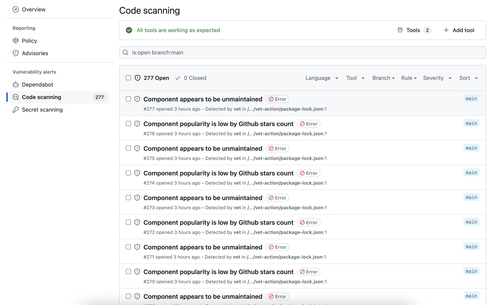
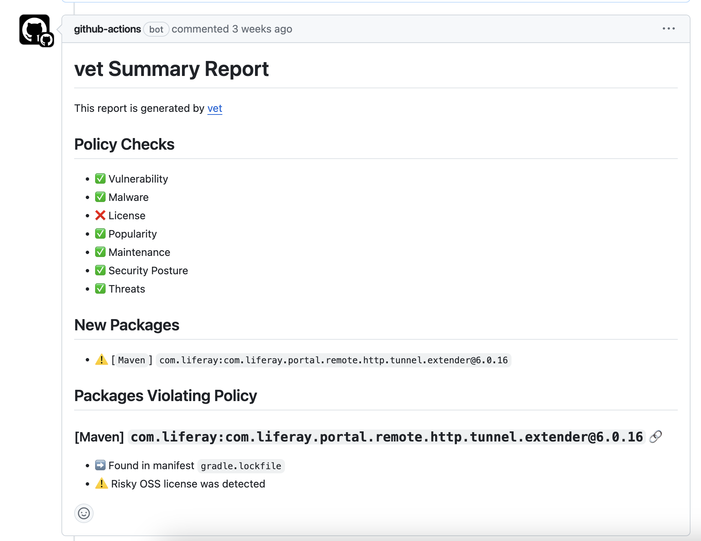

GitHub supports [uploading SARIF](https://docs.github.com/en/code-security/reference/code-scanning/sarif-files/sarif-support) reports for repository and organization-wide visibility of security events. `vet` exports its findings as SARIF for upload to GitHub Code Scanning.

## Quick Setup with GitHub Action

`vet` has a dedicated GitHub Action, which is the recommended approach for most teams.

### Basic Configuration

<Info>
The SARIF upload needs GitHub Code Scanning on in your repository. See [Configure code scanning](https://docs.github.com/en/code-security/how-tos/find-and-fix-code-vulnerabilities/configure-code-scanning).
</Info>

Create `.github/workflows/vet.yml` in your repository:

```yaml
name: OSS Security Scan
on:
  push:
    branches: [ main ]
  pull_request:
    branches: [ main ]

permissions:
  contents: read
  issues: write
  pull-requests: write
  security-events: write

jobs:
  vet-scan:
    runs-on: ubuntu-latest
    steps:
      # In production, pin each action to a full commit SHA.
      - name: Checkout
        uses: actions/checkout@v4

      - name: Run vet
        id: vet
        uses: safedep/vet-action@v1
        env:
          GITHUB_TOKEN: ${{ secrets.GITHUB_TOKEN }}

      - name: Upload SARIF
        if: steps.vet.outputs.report != ''
        uses: github/codeql-action/upload-sarif@v4
        with:
          sarif_file: ${{ steps.vet.outputs.report }}
          category: vet
```

The action supports the `push`, `pull_request` and `pull_request_target` events.

- **On a push,** the action scans the repository and writes the SARIF report.
- **On a pull request,** the action scans only the packages that the pull request adds or changes in its manifests. When a package breaks the policy, the check fails and the SARIF upload step does not run. If the pull request changes no manifest, the `report` output is empty, so the upload step does not run.

The [example workflow](https://github.com/safedep/vet-action/blob/main/example/vet-ci.yml) pins `actions/checkout` to a commit SHA.

To report the findings without blocking the merge, for example while you tune the policy, set `continue-on-error: true` on the vet step. The action still adds its pull request comment.

### Advanced Configuration

To use a custom policy, set `policy-v2` to a policy file in the [v2 format](https://github.com/safedep/vet/blob/main/samples/policy-v2.yml). It takes precedence over `policy`, which takes an older [filter suite](/reference/policy-as-code) file. Without either input, the action uses its default policy.

```yaml
- name: Run vet with custom policy
  id: vet
  uses: safedep/vet-action@v1
  with:
    policy-v2: '.github/vet/policy.yml'
  env:
    GITHUB_TOKEN: ${{ secrets.GITHUB_TOKEN }}
```

Other inputs that you often need:

- `enable-comments-proxy: true`: comments on a pull request from a forked repository. The `GITHUB_TOKEN` of a fork cannot comment.
- `exclude`: a comma-separated list of path patterns that the scan skips.
- `cloud: true`, with `cloud-key` and `cloud-tenant`: syncs the report with SafeDep Cloud, and queries the malware data with your tenant API key instead of the community API. See [Sync from GitHub Actions](/governance/cloud/sync#sync-from-github-actions).
- `paranoid: true`: in cloud mode, also treats as malicious the packages that the malware analysis marks with medium confidence or higher, before SafeDep verifies them.

For every input, see [Configuration](https://github.com/safedep/vet-action#configuration) in the vet-action README.

## Manual SARIF Generation

To generate a SARIF report using the `vet` CLI:

```bash
vet scan -D /path/to/project --report-sarif /path/to/report.sarif
```

<Note>
By default the SARIF report includes vulnerabilities and malware findings. To also report policy violations, pass a policy with `--policy` or `--policy-suite` during the scan. To leave out vulnerabilities or malware, set `--report-sarif-vulns=false` or `--report-sarif-malware=false`.
</Note>

## Viewing Results

Once uploaded, the findings appear in the GitHub Security tab, giving a centralized view across repositories.



## Pull Request Integration

On each pull request that changes a manifest, the GitHub Action adds a comment with the vet report. On the next run, it updates the same comment.



## Troubleshooting

<AccordionGroup>
  <Accordion title="SARIF Upload Fails">
    Ensure the `security-events: write` permission is set in your workflow file and that Code Scanning is enabled for your repository.
  </Accordion>
  
  <Accordion title="No Violations Reported">
    Check that your policy configuration is correct and that violations actually exist. Use `--report-json` locally to debug.
  </Accordion>
</AccordionGroup>

<CardGroup cols={2}>
  <Card title="Sync to SafeDep Cloud" icon="cloud" href="/governance/cloud/sync#sync-from-github-actions">
    Send the scan results of each run to SafeDep Cloud
  </Card>
  <Card title="Policy as Code" icon="file-shield" href="/reference/policy-as-code">
    Write the filter suite that the action enforces
  </Card>
  <Card title="vet-action Repository" icon="github" href="https://github.com/safedep/vet-action">
    View the complete documentation and examples
  </Card>
  <Card title="Full Example Workflow" icon="file-code" href="https://github.com/safedep/vet-action/blob/main/example/vet-ci.yml">
    See a complete GitHub Actions workflow example
  </Card>
</CardGroup>
