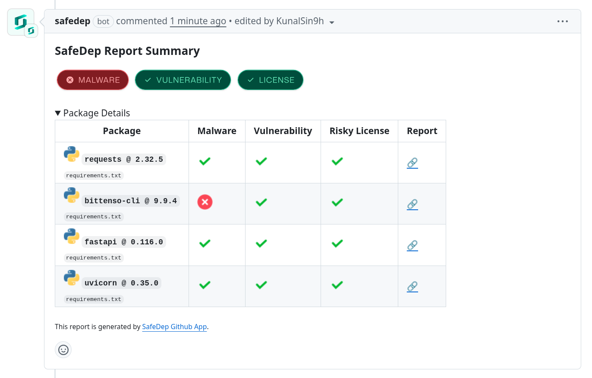
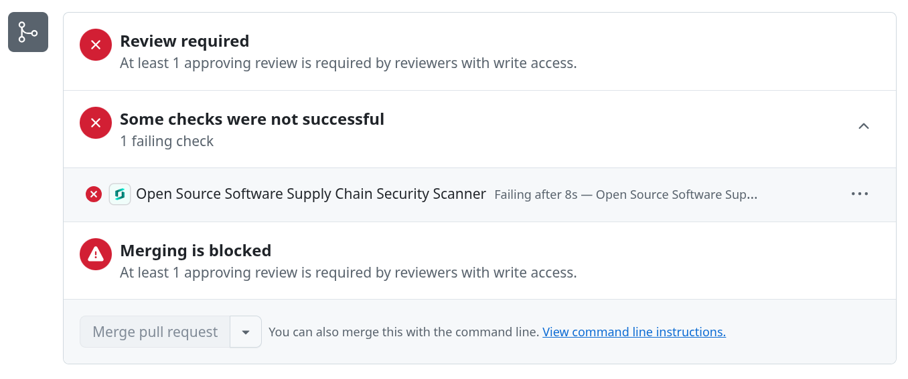

The [SafeDep GitHub App](https://github.com/apps/safedep) scans pull requests for supply-chain risk directly in GitHub. It is a hosted service run by SafeDep, so unlike the [GitHub Action](https://github.com/safedep/vet-action) there is nothing to configure or run yourself: it activates immediately after installation.

- Zero-configuration installation with immediate visibility of security findings
- Protects against malicious open source packages, known vulnerabilities, and risky licenses
- Free for public open source repositories. Private (commercial) repositories need a [SafeDep subscription](https://safedep.io/pricing)
- Optionally link the installation to your [SafeDep Cloud](/governance/cloud/overview) tenant for centralized policy and reporting across repositories

## How to Install

1. Navigate to [SafeDep GitHub App](https://github.com/apps/safedep)
2. Click _Install_
3. Follow the instructions to install the app in your GitHub organization or repository

## How to Use

The SafeDep GitHub App automatically scans pull requests for open source dependency changes. Newly introduced or updated dependencies are checked for vulnerabilities and malware.

### Reports

On every pull request, the app scans updated packages and reports on:

- [Malicious / Suspicious](/package-security/scan/malware-lookup)
- [Vulnerabilities](#appendix)
- [Risky Licenses](#appendix)

### Active Protection

When any report fails, the GitHub App **Check** fails and blocks the branch from merging.

The check fails if any _Verified Malicious Package_, _Vulnerability_, or _Risky License_ is found.

### Cloud Policy

When the installation is linked to a SafeDep Cloud tenant on the Team or Enterprise plan, the check reads the [cloud policy](/governance/cloud/policy/overview) of the tenant. The policy decides the lowest vulnerability severity and the licenses that fail the check, and its block and trust entries apply to the packages of the pull request. Verified malware always fails the check. With no cloud policy, the SafeDep default policy applies: the check fails on `CRITICAL` and `HIGH` vulnerabilities and on nine GPL and AGPL licenses, as above.

A failing check shows a policy block in the comment and in the check run output. The block names the policy revision and the rule or setting that failed each finding. See [Fail Pull Request Checks](/governance/cloud/policy/pull-request-checks).

## Appendix

### Vulnerabilities

- Checks for `CRITICAL` or `HIGH` severity vulnerabilities.
- Uses [OSV](https://osv.dev) as the vulnerability database.

### Risky Licenses

- The SafeDep default policy classifies the following licenses as **Risky**, and the check fails on them. A tenant with the cloud policy can change the list. See [Fail Pull Request Checks](/governance/cloud/policy/pull-request-checks#deny-a-license).

  - `GPL-2.0`
  - `GPL-2.0-only`
  - `GPL-2.0-or-later`
  - `GPL-3.0`
  - `GPL-3.0-only`
  - `GPL-3.0-or-later`
  - `AGPL-3.0`
  - `AGPL-3.0-only`
  - `AGPL-3.0-or-later`

### Supported Lockfiles

Supported lockfiles and ecosystems:
  1. **NPM**
  - `package-lock.json`
  - `pnpm-lock.yaml`
  - `yarn.lock`
  2. **GoLang**
  - `go.mod`
  3. **PyPI**
  - `requirements.txt`
  - `uv.lock`
  - `poetry.lock`
  - `Pipfile.lock`
  4. **RubyGems**
  - `Gemfile.lock`
  5. **Cargo (Rust)**
  - `Cargo.lock`
  6. **Packagist (PHP)**
  - `composer.lock`
  7. **Maven (Java)**
  - `pom.xml`
  - `gradle.lockfile`

<CardGroup cols={2}>
  <Card title="GitHub Code Scanning" icon="github" href="/governance/integrations/github-code-scanning">
    Surface Vet findings in GitHub code scanning via SARIF.
  </Card>
  <Card title="Platform Integrations" icon="plug" href="/governance/integrations/overview">
    Wire Vet into other CI/CD platforms.
  </Card>
  <Card title="Vet Quickstart" icon="rocket" href="/governance/vet/quickstart">
    Scan a repository from the CLI.
  </Card>
  <Card title="Fail Pull Request Checks" icon="code-pull-request" href="/governance/cloud/policy/pull-request-checks">
    Set the policy that the app enforces.
  </Card>
</CardGroup>
