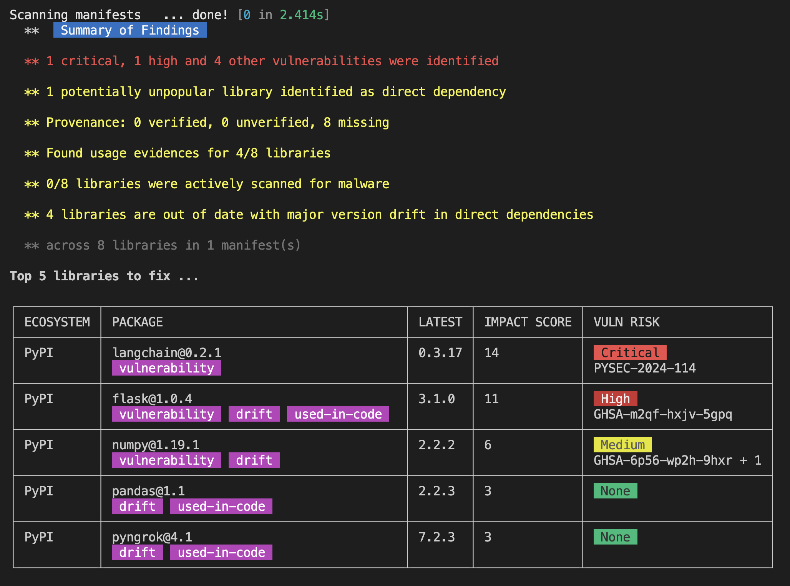

<Warning>
**EXPERIMENTAL**: This feature is experimental and may introduce breaking changes.
</Warning>

`vet` uses the [code](https://github.com/safedep/code/) analysis framework built on [tree-sitter](https://tree-sitter.github.io/tree-sitter/) parsers. The framework supports multiple languages and source repositories (local and remote), and writes findings to a SQLite database that `vet scan` uses to enrich manifest analysis.

Use it to see which dependencies your code actually uses. When you triage vulnerabilities, put the packages that the code imports first, and deprioritize the packages that are only declared.

## Build a Code Analysis Database

Build a SQLite database from your source code. The database is a prerequisite for code analysis features in `vet scan`.

```bash
vet code scan --app /path/to/app \
    --db /tmp/code.db \
    --lang python
```

This command analyzes application code recursively in the specified directory and creates a SQLite database with the findings. Omit `--lang` to scan all supported languages.

### Supported Languages

The code analysis framework supports these languages through tree-sitter parsers:

- Python
- JavaScript/TypeScript
- Java
- Go
- And more...

## Scan with Dependency Usage Analysis

Pass the database to `vet scan` via the `--code` flag. Dependency usage analysis is enabled by default when a code database is provided.

```bash
vet scan -D /path/to/code --code /tmp/code.db
```

With a code database, `vet scan` adds:

1. **Manifest Analysis**: scans package manifests in the specified directory
2. **Usage Enrichment**: enriches packages with dependency usage data from the database
3. **Evidence-Based Results**: shows a scan summary with usage evidence and `used-in-code` tags for packages confirmed as used in code



### Usage evidence

The code analysis records these types of evidence:

<Tabs>
  <Tab title="Import Statements">
    ```python
    # Python example
    import requests
    from flask import Flask
    ```
    These direct imports are tracked as usage evidence.
  </Tab>

  <Tab title="Function Calls">
    ```javascript
    // JavaScript example
    const axios = require('axios');
    axios.get('https://api.example.com');
    ```
    Actual usage of imported modules is recorded.
  </Tab>

  <Tab title="Module References">
    ```java
    // Java example
    import org.apache.commons.lang3.StringUtils;
    String result = StringUtils.capitalize(input);
    ```
    References to specific classes and methods are tracked.
  </Tab>
</Tabs>

Dependencies found in your source code get the `used-in-code` tag, so you can prioritize them over packages that are only declared in a manifest.

### Demo

<iframe
  width="100%"
  height="400"
  src="https://www.youtube.com/embed/yFUuMMAsnfI?si=hqL3SIIMjlN_kNpr"
  title="Dependency Usage Identification Demo"
  frameBorder="0"
  allow="accelerometer; autoplay; clipboard-write; encrypted-media; gyroscope; picture-in-picture; web-share"
  allowFullScreen
></iframe>

## Practical Example

Full workflow for a Python project:

<Steps>
  <Step title="Analyze Code">
    Build the code analysis database for your Python project:
    ```bash
    vet code scan --app ./src \
        --db ./analysis/code.db \
        --lang python
    ```
  </Step>
  
  <Step title="Enhanced Scan">
    Run `vet scan` with the code database:
    ```bash
    vet scan -D . \
        --code ./analysis/code.db \
        --report-json results.json
    ```
  </Step>
  
  <Step title="Review Results">
    Check the scan results for:
    - Dependencies actually used in code vs. declared
    - Unused dependencies that could be removed
    - Usage patterns and import analysis
  </Step>
</Steps>

## Advanced Usage

### Multi-language Projects

For projects with multiple languages, omit the `--lang` flag:

```bash
vet code scan --app ./src --db ./analysis/polyglot.db
```

To scan only JavaScript and TypeScript, use `--lang javascript`.

### Custom Database Locations

Organize databases by project or environment:

```bash
# Development environment
vet code scan --app ./src --db ./analysis/dev-code.db

# Production analysis
vet code scan --app ./dist --db ./analysis/prod-code.db
```

### Integration with CI/CD

```yaml
# GitHub Actions example
- name: Build Code Analysis DB
  run: vet code scan --app ./src --db ./code-analysis.db

- name: Enhanced Security Scan
  run: vet scan -D . --code ./code-analysis.db --report-sarif security.sarif
```

## Limitations

<AccordionGroup>
  <Accordion title="Experimental Status">
    This feature is experimental and may have breaking changes. Test before using in production.
  </Accordion>
  
  <Accordion title="Performance Impact">
    Code analysis adds processing time to scans. Weigh the accuracy benefit against the speed cost for your use case.
  </Accordion>
  
  <Accordion title="Storage Requirements">
    Code analysis databases can grow large for extensive codebases. Monitor disk usage and remove old databases periodically.
  </Accordion>
</AccordionGroup>

<CardGroup cols={2}>
  <Card title="Code Framework" icon="github" href="https://github.com/safedep/code/">
    Learn more about the underlying code analysis framework
  </Card>
  <Card title="Tree-sitter" icon="tree" href="https://tree-sitter.github.io/tree-sitter/">
    Understand the parsing technology behind code analysis
  </Card>
  <Card title="Policy as Code" icon="file-code" href="/reference/policy-as-code">
    Create policies that use the usage information
  </Card>
  <Card title="Vet GitHub Repository" icon="book" href="https://github.com/safedep/vet">
    Access the main Vet documentation and examples
  </Card>
</CardGroup>