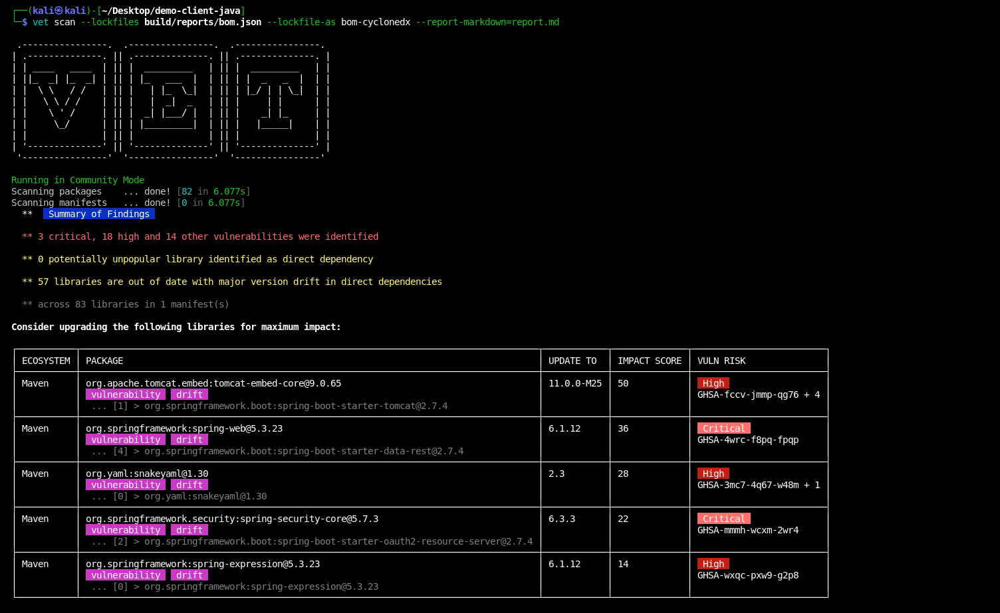

Package managers such as Maven, Gradle, and npm have the most accurate view of library dependencies. They resolve exact versions and can generate an SBOM for `vet` to scan with higher fidelity.

Vet also reads manifests and lockfiles directly, such as `package-lock.json`, `requirements.txt`, `pom.xml` and `gradle.lockfile`. Generate an SBOM when you need the dependencies that the build tool resolves.

## Generate the SBOM

<Warning>
Vet reads CycloneDX 1.0 to 1.6. It cannot read a CycloneDX 1.7 SBOM. Set the build tool to write 1.6.
</Warning>

<Tabs>
  <Tab title="Gradle">
    Apply the [CycloneDX Gradle plugin](https://github.com/CycloneDX/cyclonedx-gradle-plugin) to the root project. Plugin 3.x needs Gradle 8.4 or later.

    ```groovy
    plugins {
        id 'org.cyclonedx.bom' version '3.6.0'
    }
    ```

    ```bash
    ./gradlew cyclonedxBom
    ```

    The SBOM for the whole build is at `build/reports/cyclonedx/bom.json`. In a multi-project build, the plugin makes one SBOM for each project and adds them to this file.

    To include only the runtime dependencies, for example in a production SBOM, set `includeConfigs` in the root `build.gradle`. To also include test dependencies, add `testRuntimeClasspath`.

    ```groovy
    import org.cyclonedx.gradle.CyclonedxDirectTask

    allprojects {
        tasks.named('cyclonedxDirectBom', CyclonedxDirectTask) {
            includeConfigs = ['runtimeClasspath']
        }
    }
    ```

    For the other options, such as the output path and the projects to skip, see [Configure the tasks](https://github.com/CycloneDX/cyclonedx-gradle-plugin#configure-the-tasks) in the plugin README.
  </Tab>

  <Tab title="Maven">
    Add the [CycloneDX Maven plugin](https://github.com/CycloneDX/cyclonedx-maven-plugin). Keep `schemaVersion` set to 1.6, because a later version of the plugin can default to 1.7.

    ```xml
    <plugin>
        <groupId>org.cyclonedx</groupId>
        <artifactId>cyclonedx-maven-plugin</artifactId>
        <version>2.9.3</version>
        <configuration>
            <projectType>application</projectType>
            <schemaVersion>1.6</schemaVersion>
            <outputName>bom</outputName>
            <outputFormat>json</outputFormat>
        </configuration>
        <executions>
            <execution>
                <phase>package</phase>
                <goals>
                    <goal>makeAggregateBom</goal>
                </goals>
            </execution>
        </executions>
    </plugin>
    ```

    ```bash
    mvn clean package
    ```

    The SBOM is at `target/bom.json`.
  </Tab>

  <Tab title="npm">
    Use [cyclonedx-npm](https://github.com/CycloneDX/cyclonedx-node-npm). Set the spec version to 1.6, because the tool defaults to 1.7.

    ```bash
    npm install -g @cyclonedx/cyclonedx-npm
    cyclonedx-npm --spec-version 1.6 --output-file sbom.json
    ```
  </Tab>

  <Tab title="Python">
    Use [cyclonedx-python](https://github.com/CycloneDX/cyclonedx-python). The subcommand depends on the project type: `environment`, `requirements`, `poetry` or `pipenv`.

    ```bash
    pip install cyclonedx-bom
    cyclonedx-py environment --pyproject pyproject.toml -o sbom.json
    ```

    Pass `--pyproject` so that the SBOM has a root component. Vet cannot read an SBOM without one.
  </Tab>
</Tabs>

## Scan the SBOM with Vet

Set `--lockfiles` to the SBOM path from the step above: `build/reports/cyclonedx/bom.json` for Gradle, `target/bom.json` for Maven, or `sbom.json` for npm and Python.

```bash
vet scan --lockfiles path/to/bom.json \
         --lockfile-as bom-cyclonedx \
         --report-markdown=report.md
```

Vet reads the SBOM as XML when the file name ends in `.xml`, and as JSON for any other name.



To scan an SPDX SBOM, use `--lockfile-as bom-spdx`. Vet reads SPDX JSON only.

```bash
vet scan --lockfiles sbom.spdx.json --lockfile-as bom-spdx
```

To list the formats that `--lockfile-as` accepts, run `vet scan parsers`. To also list the experimental formats, add `--experimental`.

## CI/CD Integration

<Tabs>
  <Tab title="GitHub Actions">
    ```yaml
    name: SBOM Scan
    on: [push, pull_request]
    
    jobs:
      sbom-scan:
        runs-on: ubuntu-latest
        steps:
          - uses: actions/checkout@v4
          
          - name: Set up JDK
            uses: actions/setup-java@v4
            with:
              java-version: '17'
              distribution: 'temurin'
              
          - name: Generate SBOM
            run: ./gradlew cyclonedxBom
            
          - name: Scan SBOM with vet
            run: |
              docker run --rm -v "$PWD:/app" ghcr.io/safedep/vet:latest \
                scan --lockfiles /app/build/reports/cyclonedx/bom.json \
                --lockfile-as bom-cyclonedx

          - name: Upload SBOM
            uses: actions/upload-artifact@v4
            with:
              name: sbom
              path: build/reports/cyclonedx/bom.json
    ```
  </Tab>
  
  <Tab title="GitLab CI">
    The vet image starts `vet` as its entrypoint. Set an empty entrypoint so that GitLab can run the script. `--report-gitlab` writes a GitLab dependency scanning report.

    ```yaml
    stages:
      - build
      - security
    
    generate-sbom:
      stage: build
      image: eclipse-temurin:17
      script:
        - ./gradlew clean build cyclonedxBom
      artifacts:
        paths:
          - build/reports/cyclonedx/bom.json
        expire_in: 1 hour
    
    security-scan:
      stage: security
      image:
        name: ghcr.io/safedep/vet:latest
        entrypoint: [""]
      script:
        - vet scan --lockfiles build/reports/cyclonedx/bom.json --lockfile-as bom-cyclonedx --report-gitlab gl-dependency-scanning-report.json
      dependencies:
        - generate-sbom
      artifacts:
        reports:
          dependency_scanning: gl-dependency-scanning-report.json
    ```

    The `dependency_scanning` report needs GitLab Ultimate.
  </Tab>
</Tabs>

To keep a record for audits, store the SBOM with each release, for example as `release-artifacts/sbom-v${VERSION}.json`.

<CardGroup cols={2}>
  <Card title="CycloneDX Gradle Plugin" icon="gradle" href="https://github.com/CycloneDX/cyclonedx-gradle-plugin">
    Complete documentation for the Gradle plugin
  </Card>
  <Card title="CycloneDX Maven Plugin" icon="maven" href="https://github.com/CycloneDX/cyclonedx-maven-plugin">
    Maven plugin documentation and examples
  </Card>
  <Card title="SBOM Generation Guide" icon="file-export" href="/governance/cyclonedx-sbom">
    Learn more about generating SBOMs with Vet
  </Card>
  <Card title="Package Manager Support" icon="package" href="https://github.com/safedep/vet/blob/main/README.md#multi-ecosystem-support">
    See all supported package managers in Vet
  </Card>
</CardGroup>
