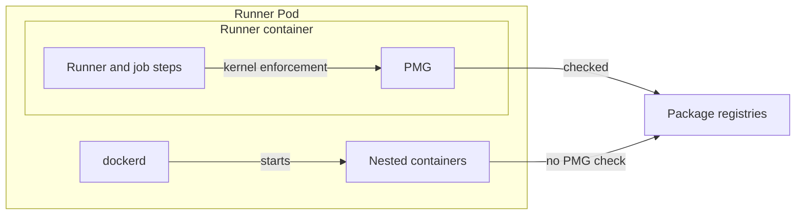

This page explains how PMG protects a self-hosted CI runner Pod on Kubernetes. To set it up, see [PMG on Self-Hosted CI Runners in Kubernetes](/package-security/pmg/kubernetes-ci-runners).

## Architecture

One PMG process runs in each runner Pod. PMG attaches to the cgroup of the runner container with [kernel enforcement](/package-security/pmg/kernel-enforcement). The kernel then sends each connection that a job step makes to a package registry through PMG. PMG checks each package and blocks a malicious one.

With summerwind ARC, dockerd runs in the runner container. With ARC runner scale sets in `dind` mode, dockerd runs in a separate `dind` sidecar container. In both cases, the nested containers that dockerd starts are in other cgroups. PMG does not route them, so they reach the registries directly.

## What the PMG entrypoint script does

The PMG image ships the PMG entrypoint script at `/opt/safedep/pmg/bin/pmg-entrypoint.sh`. When the Pod starts, `pmg-entrypoint.sh` does these steps before the runner starts:

1. It moves the processes of the runner container into a child cgroup. PMG attaches to this cgroup. The runner and every job step start in it. With summerwind ARC, dockerd also starts in it.
2. It writes the PMG config to `/etc/safedep/pmg/config.yml` if no file is there.
3. It makes a new certificate authority (CA) for the Pod and adds it to the trust store of the runner container. The private key of the CA stays in the Pod.
4. It starts PMG with kernel enforcement.
5. It gives job steps the trust variables `NODE_USE_SYSTEM_CA`, `NODE_EXTRA_CA_CERTS`, `REQUESTS_CA_BUNDLE`, `UV_NATIVE_TLS`, and `PMG_CA_BUNDLE`. These variables make the package managers trust the PMG CA.
6. It starts a supervisor. The supervisor starts PMG again if PMG stops.
7. It runs the runner start command from `CMD`, such as `entrypoint-dind.sh` or `/home/runner/run.sh`. This command starts the runner.

When the Pod stops, Kubernetes sends a stop signal to `pmg-entrypoint.sh`. `pmg-entrypoint.sh` stops the runner first. Then it stops PMG, so PMG checks installs until the runner stops.

An image that starts PMG from its own entrypoint script calls `pmg-entrypoint.sh` with an argument. With `start`, `pmg-entrypoint.sh` starts PMG, writes the trust variables to `/run/pmg/env`, and returns. With `stop`, it stops PMG.

## What PMG covers

| Where the install runs | Checked by PMG |
| --- | --- |
| A job step in the runner container, such as `run: npm ci` | Yes |
| A process that `kubectl exec` starts in the runner container | Yes |
| `docker build` or `docker run` in a job step | No. It works as before. |
| A job with `container:`, or a service container | No. It works as before. |
| Another Pod on the same node | No. PMG does not change it. |

PMG decrypts only the connections to package registries. Other hosts keep their real certificates.

## Where the SafeDep Cloud keys go

`pmg-entrypoint.sh` reads `SAFEDEP_API_KEY` and `SAFEDEP_TENANT_ID` from the files of the mounted Secret. It gives them only to PMG. They are not in the environment of the runner or the job steps.

SafeDep Cloud is on only when both keys are present. Without them, PMG blocks malicious packages with no cloud policy and no event sync. PMG sends its events to SafeDep Cloud every 15 seconds while it runs.

## Limits

- **PMG does not check nested containers.** This includes `docker build`, `docker run`, job containers, and service containers. They work as before, with no PMG check.
- **A step that does not trust the PMG CA cannot reach the registries.** The step fails closed. It cannot go around PMG.
- **If PMG stops, installs pass with no check until PMG starts again.** The kernel hook stops with PMG. The supervisor starts PMG again.
- **A job step with root access can stop PMG.** For example, a step that uses `sudo`. PMG blocks malicious packages. It does not stop a workflow that is written to turn PMG off.
- **PMG does not support the `safedep/pmg` GitHub Action on these runners.** The action and kernel enforcement cannot run on the same runner.

<CardGroup cols={2}>
  <Card title="PMG on Self-Hosted CI Runners in Kubernetes" icon="dharmachakra" href="/package-security/pmg/kubernetes-ci-runners">
    Add PMG to your runner image and start it in each runner Pod.
  </Card>
  <Card title="Kernel Enforcement on Linux" icon="microchip" href="/package-security/pmg/kernel-enforcement">
    See how the kernel routes package installs through PMG on a Linux host.
  </Card>
</CardGroup>
